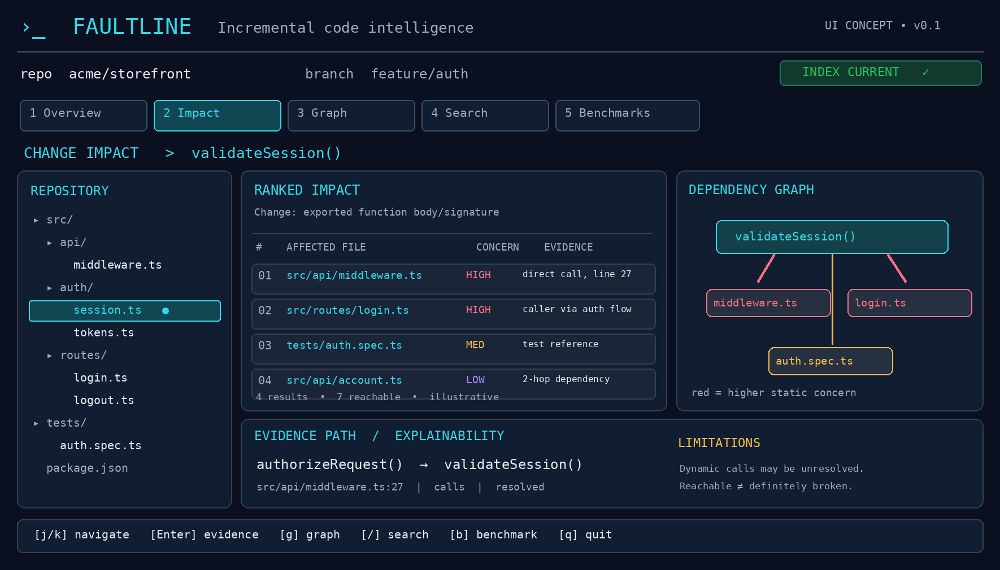
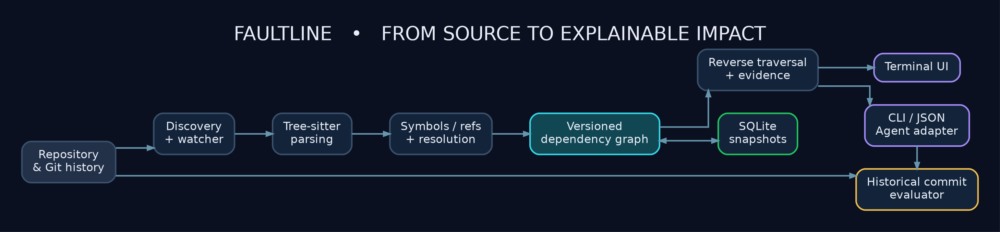
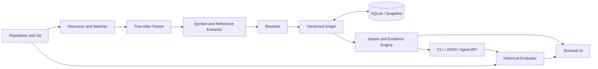
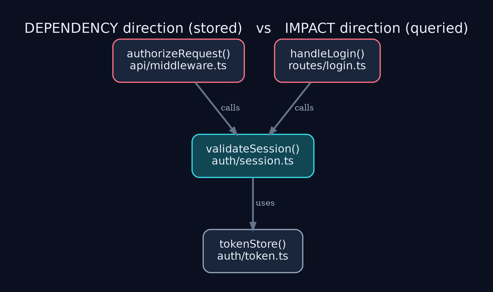
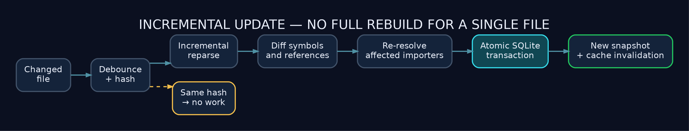
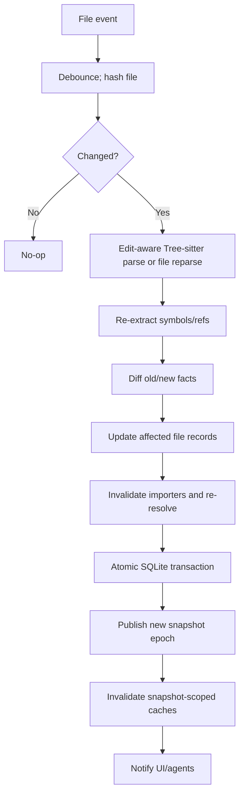

# FAULTLINE
## Complete Product, Architecture, Terminal Interface, and Implementation Blueprint

**Status:** design specification, not implemented software  
**Document version:** 1.0 · 20 November 2026  
**Primary audience:** two Rust developers using Codex, engineers evaluating the repository, and future contributors  
**Companion:** [02_TWO_PERSON_EXECUTION_PLAYBOOK.md](02_TWO_PERSON_EXECUTION_PLAYBOOK.md)

> **Product promise:** Given a changed source symbol or Git diff, find the functions, files, and tests that may be affected, rank the results, and explain each result with source-backed dependency paths. Keep the graph current without reparsing the entire repository.



**Figure 1.** Proposed terminal layout. Illustrative content and latency values; this is a design mockup, not an execution screenshot.

---

## 1. Executive decision

Build a **local-first, deterministic, inspectable code intelligence engine** in Rust. Initial scope: **TypeScript and JavaScript** using Tree-sitter. An optional agent adapter may consume the engine's structured API. Do **not** start with an LLM, cloud database, visualization framework, or ten languages.

Existing repo maps, code browsers, and indexers make simple indexing insufficiently differentiated. FAULTLINE must win credibility through **(1) incremental/full-build equivalence, (2) traceable impact evidence, (3) realistic benchmarks, and (4) a fast, polished TUI.** None of those are assumed achievements before testing.

### Goals and non-goals

| Goals for v1 | Explicit non-goals for v1 |
|---|---|
| Scan actual repositories safely and offline | Execute untrusted repo source code |
| Resolve many TS/JS imports, symbols and references | Complete TypeScript type checking |
| Traverse reverse dependencies and explain why | Guarantee actual runtime failure |
| Incrementally refresh changed file facts and dependents | Perfect dynamic dispatch or reflection analysis |
| Expose deterministic CLI and JSON | Autonomous code editing / LLM chat |
| Offer keyboard-only, responsive terminal UI | Browser dashboard or hosted SaaS |
| Prove retrieval quality on held-out historical commits | Fabricated 'accuracy', 'K-factor', or performance numbers |

### Primary users and workflows

1. **Human developer:** explore a new repo → search `validateSession` → press `i` → inspect consumers, confidence, and evidence → change function → watch affected graph update.
2. **Agent:** call `faultline impact --diff ... --json` → receive ranked, token-bounded references → inspect exact file locations, not a giant repository dump.
3. **Evaluator:** mine a commit set → reconstruct parent snapshots → rank related files → report true Recall@k/MRR/nDCG with naive-baseline comparisons.

### Acceptance definition

A demo is complete when a developer can index a representative TS repo, query a symbol, see **accurate source-range evidence**, edit that symbol, observe **incremental refresh**, export JSON from the same snapshot, and run a **reproducible benchmark**. The result explicitly discloses unresolved references and graph coverage.

---

## 2. System illustrations



**Figure 2.** Repository ingestion → semantic facts → versioned graph → impact and agents. The evaluator runs independently against frozen snapshots.

### Architecture contract



The engine is a library, not a terminal app. Its public API returns owned, versioned, serializable DTOs. Rendering and benchmark consumers must never manipulate parser-owned Tree-sitter nodes or internal graph IDs directly.

### Runtime components

| Component | Responsibilities | Owned by |
|---|---|---|
| `faultline-contract` | Shared immutable DTOs and interface traits | Freeze jointly before parallel work |
| `faultline-parser` | TS/JS grammars, extraction, scopes, module facts | Engine developer |
| `faultline-core` | IDs, graph adjacency, impact traversal, ranker | Engine developer |
| `faultline-index` | Discovery, watcher, incremental invalidation, SQLite | Engine developer |
| `faultline-engine` | Public `EngineApi` implementation and JSON bridge | Engine developer |
| `faultline-cli` | `clap` subcommands and machine-readable IO | Experience developer |
| `faultline-tui` | Ratatui screens, event loop and keyboard UX | Experience developer |
| `faultline-eval` | Commit miner, baselines, evaluator, report generation | Experience developer |
| `faultline-testkit` | Deterministic mock `EngineApi` and demo fixtures | Experience developer |

---

## 3. Terminal-first product

### Design system

- **Surface:** midnight `#0B1020`, panels `#121C2D`, subdued dividers `#344055`.
- **Text:** primary `#E8EDF8`, secondary `#A0ABC2`.
- **Semantics:** cyan `#35D9E8` navigation/selection; green `#22C55E` resolved/current; amber `#F2BD4B` incomplete/uncertain; red `#FB7185` high-impact evidence; violet `#A78BFA` active query.
- **Typography:** monospace; Unicode box drawing and Nerd Font icons only when supported, safe ASCII fallback everywhere.
- **Accessibility:** color is never the only signal; include text labels and shapes; monochrome/`NO_COLOR` mode; avoid flicker and animation without value.

### Navigation and primary views

| Screen | Main panels | Required behavior |
|---|---|---|
| `1 Overview` | Repo tree, language coverage, index health, activity | Jump into symbol or file |
| `2 Impact` | Selected symbol/diff, ranked results, evidence path | Evidence inspection from every row |
| `3 Graph` | Focus node, caller/callee subgraph, edge legend | Direction labels; cap visible nodes |
| `4 Search` | Fuzzy names, file paths, symbols, refs | Search is debounced and keyboard navigable |
| `5 Benchmarks` | Recall@k, MRR, latency, comparisons | Show `not measured` until actual run |
| `6 Timeline` | File changes, invalidations, snapshots | Show stale/current status and timing |

**Impact screen layout (wide terminal):** header/repo status → left repo tree (22%) → center result table (48%) → right graph (30%) → bottom evidence details and warnings → footer shortcuts. 80–119 columns: collapse right graph; below 80: single panel and tabs. Below 20 rows: compact status.

**Keyboard:** `1..6` views; `j/k` move; `h/l` collapse/expand; `/` search; `i` impact; `g` graph; `Enter` evidence/source; `Tab` focus; `b` benchmarks; `?` help; `q` quit; `Esc` dismiss. Maintain focus and scroll when switching panels.

### State and update rules

- UI is a pure projection of `AppState` + latest `EngineApi` results; engine calls occur on a worker, never in the draw function.
- A request contains a snapshot ID and request ID. Drop late replies if the user has navigated elsewhere. Label stale results explicitly.
- Render only on state changes, resize, or necessary progress ticks. Exit always restores the terminal even after error/panic.
- Never show a high/medium label as a probability of breakage. Labels describe **static concern** or evidence quality.

### Proposed benchmark screen

```
┌─ FAULTLINE / BENCHMARKS ──────────────── dataset: history-v1 ───┐
│ STATUS: NOT MEASURED       last run: —      commits: —         │
│                                                             │
│ Recall@5   —      Recall@10  —      MRR       —              │
│ p95 query  —      p95 update  —      index size —            │
│                                                             │
│ Lexical search  [not measured]                              │
│ Import-only     [not measured]                              │
│ FAULTLINE       [not measured]                              │
│                                                             │
│ [r] run   [d] dataset   [e] export   [?] metric definition  │
└─────────────────────────────────────────────────────────────┘
```

**Honesty requirement:** until a benchmark runs, show em dashes and `not measured`. Demo-only fixture data must be marked `demo`.

---

## 4. Graph semantics and correctness

### Direction convention

Every stored dependency edge has the form **`consumer → dependency`**. If `authorizeRequest` calls `validateSession`, store `authorizeRequest → validateSession`. To answer **what may be affected if `validateSession` changes**, traverse **incoming** edges.



**Figure 3.** Dependency direction and reverse traversal are deliberately different. Never silently reverse the semantic direction in storage.

### Entities

- `File`: normalized repository-relative path, language, content hash, parser version, root ID, deleted/ignored flag.
- `Symbol`: stable logical ID where possible, qualified name, kind, parent ID, file ID, byte/line range, signature hash, export status.
- `Reference`: source symbol and location, target symbol if resolved, resolution state, candidate count, evidence type.
- `Edge`: consumer symbol, dependency symbol, type, source evidence range, resolution confidence. Duplicate call sites are separate evidence for the same logical relation.
- `Snapshot`: monotonically increasing epoch, Git revision if known, file manifest hash, resolver configuration hash, update sequence.
- `ChangeSet`: old/new snapshot IDs, changed paths, added/removed/modified symbols, signature/body/metadata classification.
- `ImpactResult`: ranked symbol or file, heuristic score, explanation paths, concern category, flags, cutoff/truncation metadata.

**Stable identity:** IDs for surviving symbols should use file identity + lexical nesting + qualified name/kind + disambiguator rather than source line numbers. Rename/move matching is best-effort; semantic identity changes must be recorded transparently. Source ranges always refer to a specific snapshot.

### Edge types and resolver rules

Required v1 edge kinds: `calls`, `imports`, `exports`, `reexports`, `type_ref`, `extends`, `implements`, `test_reference`. Resolver recognizes TS/JS relative import/export syntax, aliases, default and named exports, index resolution, `tsconfig` path aliases where configured, scope shadowing, and cycles. External package references remain labeled external; unknown dynamic calls remain unresolved, not fabricated edges.

**Tree-sitter is not a type checker.** Type-level overloads, runtime dependency injection, dynamic property access, aliases through complex reexports, and reflection require explicit limitations. Build resolver tests for shadowed names, duplicate symbol names, barrel exports, import cycles, and file renames.

### SQLite outline

```sql
CREATE TABLE snapshots (
  epoch INTEGER PRIMARY KEY,
  git_revision TEXT,
  manifest_hash TEXT NOT NULL,
  created_at TEXT NOT NULL
);
CREATE TABLE files (
  file_id TEXT PRIMARY KEY,
  path TEXT NOT NULL UNIQUE,
  language TEXT NOT NULL,
  content_sha256 TEXT NOT NULL,
  parser_version TEXT NOT NULL
);
CREATE TABLE symbols (
  symbol_id TEXT PRIMARY KEY,
  file_id TEXT NOT NULL,
  qualified_name TEXT NOT NULL,
  kind TEXT NOT NULL,
  start_byte INTEGER NOT NULL,
  end_byte INTEGER NOT NULL,
  signature_hash TEXT
);
CREATE TABLE graph_edges (
  edge_id TEXT PRIMARY KEY,
  source_symbol_id TEXT NOT NULL,
  target_symbol_id TEXT,
  edge_type TEXT NOT NULL,
  evidence_file_id TEXT NOT NULL,
  evidence_start_byte INTEGER NOT NULL,
  resolution_state TEXT NOT NULL
);
CREATE INDEX graph_edges_target ON graph_edges(target_symbol_id);
CREATE INDEX graph_edges_source ON graph_edges(source_symbol_id);
CREATE INDEX symbols_file ON symbols(file_id);
```

This is a **minimal outline**, not a final migration. Add normalized reference records, snapshot coherence, schema versioning, foreign keys, relevant indexes, and migration tests before release. WAL with one writer and snapshot-consistent readers is the starting concurrency model.

---

## 5. Incremental indexing



**Figure 4.** Change only the necessary file facts and dependent resolution records; persist atomically and invalidate versioned query caches.



### Algorithm, exact order

1. Discover source files using `.gitignore` rules and explicit allow/deny lists. Exclude `.git`, `node_modules`, build outputs, `.faultline`, and generated files by default. Canonicalize boundaries to stay inside the chosen repo root.
2. Hash file contents; debounce bursty watcher events. Handle events being coalesced, reordered, or lost with periodic manifest reconciliation.
3. If previous bytes/tree exist, construct a correct `InputEdit` (byte offsets **and** row/column coordinates), edit the old Tree-sitter tree, and parse new content with the edited tree. Otherwise reparse that file fully.
4. Extract semantic facts for the file; compare **full extracted facts and relevant hashes**, not just Tree-sitter's structurally changed ranges.
5. Remove old facts for the changed/deleted file, upsert new facts, identify changed exported names/import resolution, then transitively re-resolve **only affected importing files** and their dependency-sensitive references.
6. Commit all graph and file-table changes as one transaction; publish the new snapshot epoch only after successful commit.
7. Invalidate query caches using snapshot ID (simple and correct in v1), and notify TUI listeners. Optimize to dependency-specific invalidation only after correctness is proven.
8. Rebuild on parser version, grammar, config, or schema incompatibility, with a clear reason in diagnostics.

**Critical invariant:** for every supported repo state `R`, `normalize(full_rebuild(R)) == normalize(incrementally_updated(R))`. Compare symbols, references, resolved edges, evidence ranges, and diagnostics; ignore only ephemeral DB row IDs and timestamps.

### Test matrix

| Scenario | Expected result |
|---|---|
| Rename an exported function | Importers invalidated; old target removed |
| Edit function body, preserve signature | File facts refreshed, consumer links preserved |
| Add/delete source file | Manifest and graph exactly match rebuild |
| Update `tsconfig` path mapping | Module resolution invalidation or rebuild |
| Rename/move module | Old import paths marked unresolved as appropriate |
| Cyclic imports | Terminates; deterministic graph |
| Rapid events / interrupted write | No partial snapshot visible |
| Unicode / CRLF edits | Correct byte + row/column evidence |
| Broken/incomplete source | Best-effort parse with explicit diagnostics |
| Graph contains high-fan-out node | Query bounded and marked partial |

---

## 6. Query algorithms and evidence

### Operations

1. `search(query, limit)`: fuzzy names and paths, no semantic hallucination.
2. `references(symbol_id)`: resolved and unresolved reference evidence.
3. `impact_symbol(symbol_id, limit, max_hops, budget)`: reverse traversal with cycle detection, ranking, and explanation path(s).
4. `impact_diff(base, head)`: classify changed symbols by comparing snapshots and merge ranked affected files. Git revisions must be materialized in isolated workspaces, never by modifying a user's working tree.
5. `context_bundle(query, token_budget)`: top-ranked source spans with file, line, snapshot and truncation metadata.

### Ranker v1

Let `p` be a path from an affected consumer to the changed dependency. Rank candidates with:

`score(v) = 100 × resolution_confidence(v) × change_weight × max_path( hop_decay^(length(p)-1) × product(edge_weight))`

Example defaults **to tune, not to claim**: `hop_decay=0.7`; `change_weight` removal/rename 1.0, incompatible signature 0.9, implementation/body 0.6; resolved direct call 1.0, resolved import 0.8, unresolved candidate 0.2. Clamp and document weights. The score is a **ranking heuristic, never a probability that a file breaks**.

Build the initial traversal as budgeted BFS over incoming edges with visited states and predecessor evidence. Bounded top-k selection runs after candidate collection; avoid an unbounded full traversal on enormous graphs. Report `truncated=true`, processed nodes, reached nodes, and reason when budgets are exhausted. Deduplicate results by file only after retaining best symbol-level evidence.

### Severity language

- `high static concern`: directly resolved consumer + known incompatible interface change.
- `medium static concern`: direct dependency without a proved incompatible contract, or a short transitive path.
- `low / uncertain`: long path, partial resolution, or mostly import-level association.

Provide evidence such as `middleware.ts:27 authorizeRequest → session.ts:42 validateSession`. Never label something **definitely broken** without compiler/test/runtime evidence.

---

## 7. Public API and CLI

### Stable interface (freeze before splitting work)

The companion playbook specifies the full working agreement. Minimal trait shape:

```rust
pub trait EngineApi: Send + Sync {
    fn health(&self) -> Result<IndexHealth, EngineError>;
    fn search(&self, request: SearchRequest) -> Result<SearchResponse, EngineError>;
    fn impact(&self, request: ImpactRequest) -> Result<ImpactResponse, EngineError>;
    fn references(&self, request: ReferencesRequest) -> Result<ReferencesResponse, EngineError>;
    fn graph(&self, request: GraphRequest) -> Result<GraphResponse, EngineError>;
}
```

**Important:** use owned types from `faultline-contract`, with explicit `schema_version`, `snapshot_epoch`, `freshness`, `truncated`, and `unresolved_count`. Either wrap synchronous calls in a worker pool or define async adapters, but do not block the TUI renderer. The final trait and DTO compilation must be done once before parallel development.

### CLI

```bash
faultline init .
faultline index . --watch
faultline ui .
faultline search "validateSession"
faultline refs 'src/auth/session.ts::validateSession' --json
faultline impact 'src/auth/session.ts::validateSession' --limit 20
faultline impact --diff HEAD~1..HEAD --json
faultline graph 'src/auth/session.ts::validateSession' --depth 3
faultline doctor
faultline bench mine --repo . --out benchmarks/history.json
faultline bench run --manifest benchmarks/history.json
faultline bench report --input benchmarks/results.json
```

**Conventions:** stdout is machine data when `--json`; logging/progress goes to stderr; exit `0` success, `2` user or query error, `3` indexing/freshness failure, `4` incomplete computation only when `--require-complete` is specified; avoid silently guessing symbols with duplicate names. All output includes schema version.

### Example impact response (illustrative)

```json
{
  "schema_version": 1,
  "snapshot_epoch": 77,
  "freshness": "current",
  "query": {"symbol": "src/auth/session.ts::validateSession"},
  "truncated": false,
  "unresolved_count": 2,
  "results": [
    {
      "file": "src/api/middleware.ts",
      "symbol": "authorizeRequest",
      "rank": 1,
      "score": 87.4,
      "score_meaning": "ranking_heuristic",
      "concern": "medium",
      "evidence_path": [
        {"consumer": "authorizeRequest", "dependency": "validateSession",
         "relation": "calls", "file": "src/api/middleware.ts", "line": 27}
      ]
    }
  ]
}
```

A later optional MCP adapter may expose read-only `search_symbols`, `find_references`, `analyze_impact`, `get_dependency_paths`, and `get_context_bundle`. MCP is **post-v1**, never a dependency for the core engine.

---

## 8. Persistence, cache, and reliability

| Layer | Storage | Invalidated by |
|---|---|---|
| Source hash manifest | SQLite | File content change |
| Parsed syntax tree | bounded in-memory LRU | File change or grammar version |
| Extracted symbol facts | SQLite, keyed by file+parser | File/config/grammar change |
| Reference resolution | SQLite | Export/import/resolver config change |
| Graph adjacency | persisted edge tables + memory index | Committed snapshot update |
| Query result cache | bounded LRU with snapshot key | Any snapshot change in v1 |
| TUI graph positions | ephemeral, keyed by subgraph | New selected subgraph |

- One writer; WAL readers; schema version migrations; rebuild path after corruption or incompatible schema.
- Write snapshot and graph changes atomically. Expose status `current`, `updating`, `stale`, `failed`, `uninitialized`.
- All result evidence ranges are associated with a snapshot; never silently combine different epochs.
- Parser and evaluator never execute scripts, package hooks, or application tests in arbitrary untrusted repositories. If future runtime breakage checks require execution, place them behind a separate opt-in sandbox policy.
- Escape ANSI/control bytes in filenames and source snippets. Apply max size/timeout/node budgets. Avoid indexing secrets unless explicitly within repo scope; do not upload code anywhere by default.

---

## 9. Evaluation design: the credibility layer

### What is and is not being measured

A real bug-fix commit may touch files A, B and C. Treat A as a seed query at **the parent revision**, and evaluate whether the engine retrieves B and C. This measures *co-change retrieval*, not proven runtime breakage. Never call this an absolute breakage accuracy score.

For genuine breakage evaluation, isolate a historical edit in a sandbox and use independent compiler/test or verified failure labels. Report this as **Track B**, separately from historical co-change **Track A**.

### Historical benchmark procedure

1. Pin repositories to Git URLs and commits, with license information; choose repos with meaningful TS/JS history.
2. Mine candidate commits by documented heuristics (e.g., bug-fix terms, linked issues, modified test/source files). Keep heuristic selection transparent.
3. Exclude merges, generated files, renames-only patches, giant refactors, formatting-only commits, binary content, and ambiguous cases; state exact exclusions.
4. Check out **parent revision** in a disposable read-only worktree. Build graph there.
5. Derive a query seed available at parent revision; use another touched source file as held-out positive label. Exclude seed file from positives. Skip cases without remaining valid positives.
6. Score ranked file predictions using only parent-state features. Never use post-fix source text or future commit labels to tune on the test split.
7. Use chronological splits within repositories and an additional held-out-repository set; choose all scoring weights on dev only.
8. Compare with (a) lexical search, (b) import graph reachability, and (c) unweighted reverse dependency ranker.
9. Publish per-repo, macro/micro results, denominators, randomization/bootstrap intervals, failure examples, and full configs.

### Metrics and formulas

- `Recall@k = relevant_files_in_top_k / all_relevant_files` per query, then macro-average.
- `Precision@k = relevant_files_in_top_k / k` (with explicit convention if fewer than k returned).
- `MRR = mean(1 / rank_of_first_relevant_file)`; 0 if none retrieved.
- `nDCG@k` using binary relevance and per-query ideal ranking.
- p50/p95 latency for cold index, incremental updates, warm queries; memory peak; index bytes; unresolved/resolved reference ratio; equivalence failures.

**No pre-filled scores.** Proposed engineering targets on a documented machine: index 5k TS/JS files, warm impact p95 <200ms, single-file update p95 <500ms, responsive UI, zero full/incremental equivalence mismatches on the supported test corpus. These are targets, not promises.

---

## 10. Detailed implementation instructions

This checklist is intentionally sequential at **dependency** level; independent workstreams run concurrently after the contract freeze described in Document 2.

### Phase 0 — repository skeleton and compileable contract

- [ ] Create Cargo workspace; root `rust-toolchain.toml`, formatting/lint settings, license, README, `.gitignore` (exclude `.faultline`, fixtures' generated dirs).
- [ ] Add minimal `faultline-contract` crate with serializable IDs, locations, requests, responses, errors, health, graph/impact DTOs, `EngineApi` trait.
- [ ] Add contract serialization fixture, `schema_version=1`, and compile-time mock implementation.
- [ ] Create **separate ownership directories** and CI. Freeze contract v1 with tagged commit `contract-v1`.
- [ ] Verify: `cargo fmt --check`, `cargo clippy --workspace --all-targets -- -D warnings`, `cargo test --workspace`.

### Phase 1 — parser, files and graph

- [ ] Implement ignore-aware discovery, language detection, content hashing, UTF-8 handling and file limits.
- [ ] Parse TS/TSX/JS/JSX using relevant Tree-sitter grammars and extraction queries.
- [ ] Extract declarations, qualified names, source ranges, signatures, imports/exports, references and scopes.
- [ ] Implement module resolver, aliases and basic symbol binding. Mark unresolved cases.
- [ ] Build directed adjacency (forward/reverse) with deterministic ordering and stable IDs.
- [ ] Test parser/resolver on fixtures: shadowing, barrel exports, cycles, alias, default exports, broken syntax.
- [ ] Gate: full rebuild gives deterministic graph and valid source-backed `refs`.

### Phase 2 — persistent indexing and impact

- [ ] Add migrations, SQLite schema and transaction-based snapshot publication.
- [ ] Add bounded incoming-edge traversal, cycle handling, evidence reconstruction and file aggregation.
- [ ] Add change taxonomy and configured heuristic scoring; clearly label score semantics.
- [ ] Support `impact_symbol`; parse Git diff into a change-set for `impact_diff`.
- [ ] Contract test: known test graph yields exact ranked results and explanation paths; bounded queries report truncation.

### Phase 3 — correct incremental maintenance

- [ ] Add watcher/debounce/hash guard and manifest reconciliation.
- [ ] Add edit-aware Tree-sitter parser reuse; handle missing buffers safely.
- [ ] Diff extracted semantic facts; invalidate affected importers; commit new snapshot atomically.
- [ ] Implement content-hash grammar/version invalidation and crash recovery.
- [ ] Write property/fuzz regression that applies random mutations and compares normalized incremental graph with full rebuild.
- [ ] Gate: 100% equality on the maintained regression corpus; no partial snapshot on forced interruption.

### Phase 4 — terminal + command surface

- [ ] Build `clap` commands against `EngineApi`, JSON serialization and documented exit codes.
- [ ] Implement mock engine for deterministic UI/eval development; no parser dependency in TUI.
- [ ] Implement Overview, Impact, Graph, Search, Benchmarks, Timeline views and keyboard shortcuts.
- [ ] Add stateful search, loading, empty/error, stale, truncated, limited-terminal-size views; terminal cleanup.
- [ ] Snapshot UI tests and a manual test matrix across terminal sizes and `NO_COLOR`.
- [ ] Gate: commands and TUI agree against the **same snapshot**; no blocking UI calls.

### Phase 5 — evaluation

- [ ] Commit miner + manifest format + reproducible sample dataset.
- [ ] Parent-revision query generation and leakage guard tests.
- [ ] Lexical, import-only and unweighted graph baselines.
- [ ] Compute Recall@k, Precision@k, MRR, nDCG with tested formulas; record percentiles of timing.
- [ ] Emit `benchmark.json`, Markdown report, machine metadata; connect TUI benchmark screen to stored runs.
- [ ] Gate: reproducible held-out run, no hard-coded metrics, explicitly scoped interpretation.

### Phase 6 — profile and release

- [ ] Profile parse, graph update, SQLite writes, reverse traversal, memory, TUI redraw.
- [ ] Add query time/node budgets, cancellation behavior, panic-safe terminal restoration.
- [ ] Verify macOS/Linux/Windows builds if supported by CI; publish checksums/binaries only after reproducible builds.
- [ ] Document installation, constraints, performance test hardware, privacy, troubleshooting, demo commands, and architecture.
- [ ] Tag `v0.1.0` only after acceptance and measurable demonstration.

---

## 11. Repository layout

```text
faultline/
├── Cargo.toml                      # workspace manifest, shared dependencies
├── AGENTS.md                       # short Codex repo rules
├── rust-toolchain.toml
├── crates/
│   ├── faultline-contract/         # frozen shared API
│   ├── faultline-core/             # graph + ranking
│   ├── faultline-parser/           # tree-sitter extraction + resolution
│   ├── faultline-index/            # persistence + watching + snapshots
│   ├── faultline-engine/           # EngineApi adapter
│   ├── faultline-cli/              # clap commands
│   ├── faultline-tui/              # ratatui app
│   ├── faultline-eval/             # commit miner, metrics, baselines
│   └── faultline-testkit/          # fake engine, fixtures
├── fixtures/
├── benchmarks/
├── docs/
│   ├── 01_FAULTLINE_PROJECT_BLUEPRINT.md
│   ├── 02_TWO_PERSON_EXECUTION_PLAYBOOK.md
│   └── assets/
└── .github/
    ├── workflows/ci.yml
    ├── CODEOWNERS
    └── pull_request_template.md
```

### Supported tools

Rust: `clap`, `ratatui`, `crossterm`, `tree-sitter` and TS/JS grammars, `ignore`, `notify`, `rayon` (where beneficial), `petgraph` or bounded adjacency maps, `rusqlite`, `serde`, `serde_json`, `tracing`. Pin supported versions at implementation time and check the grammar/compiler API actually compiles; do not hard-code speculative versions in this document.

---

## 12. Release gates and demonstrator script

| Gate | Machine-checkable exit criterion |
|---|---|
| Build | Workspace formats, lints and tests cleanly |
| Parser | Fixture symbols/references and ranges match expected outputs |
| Graph | Edge orientation and evidence paths deterministic |
| Incremental | Incremental/full equality for all supported edit fixtures |
| Reliability | Atomic state on crashes, stale snapshots disclosed, terminal restored |
| UI | No blocking on index calls; narrow/monochrome fallback |
| Bench | Sample sizes, leakage defenses, baseline and actual values reported |
| Agent use | JSON validates against frozen schema, bounded context |

**Demo, in order:** `faultline init .` → `faultline ui` → search `validateSession` → `i` impact → inspect `Enter` evidence path → edit exported function → watch incrementally updated snapshot → `faultline impact --diff ... --json` → run benchmark against baselines. Record actual values; no fabricated screenshots described as measurements.

### Open engineering risks

- TS/JS resolution precision remains imperfect without compiler index data; optionally ingest SCIP later.
- High fan-out and reexport hubs need node/time budgets.
- Historical fix commits contain noisy co-change labels and selection bias.
- File watching is not a perfect event log; periodic reconciliation is essential.
- Full support for diff impact needs robust old/new symbol mapping; ship symbolic impact before polished Git-diff ranking.

---

## 13. References (verification resources)

- Tree-sitter advanced incremental parsing: <https://tree-sitter.github.io/tree-sitter/using-parsers/3-advanced-parsing.html>
- Ratatui docs: <https://docs.rs/ratatui/latest/ratatui/>
- GitHub protected branches: <https://docs.github.com/en/repositories/configuring-branches-and-merges-in-your-repository/managing-protected-branches>
- GitHub CODEOWNERS: <https://docs.github.com/en/repositories/managing-your-repositorys-settings-and-features/customizing-your-repository/about-code-owners>
- Codex cloud environments: <https://learn.chatgpt.com/docs/environments/cloud-environments>

**Design principle:** deliberately distinguish *facts* (source locations, resolved references, historical labels) from *heuristics* (rank, concern level) and from *unknowns* (unresolved dynamic dependencies, unmeasured accuracy).
