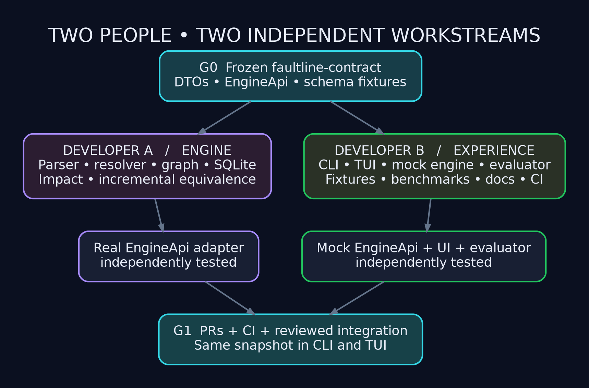
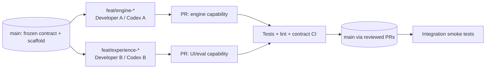
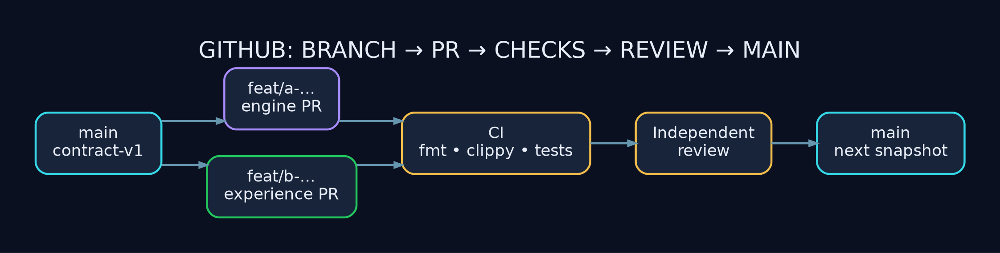
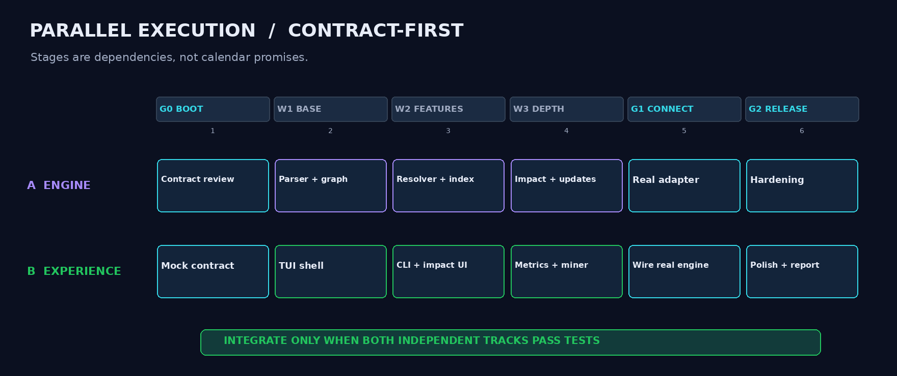

# FAULTLINE: TWO-PERSON PARALLEL DELIVERY PLAYBOOK
## Independent Codex Workstreams on One Cloud GitHub Repository

**Status:** execution plan, ready to paste into a repository  
**Document version:** 1.0 · 20 November 2026  
**Companion:** [01_FAULTLINE_PROJECT_BLUEPRINT.md](01_FAULTLINE_PROJECT_BLUEPRINT.md)

> **Fastest safe approach:** one GitHub source of truth, one tiny frozen API contract, two independent domains, one mock adapter, two isolated branches or cloud workspaces, short pull requests, mandatory CI, and integration only at explicit milestones. **Do not have both Codex agents freely edit the same repository files.**



**Figure 1.** Both developers independently implement different layers against a common contract. Developer B's mock means the UI and benchmark code can run before Developer A's parser exists.

---

## 1. Executive recommendation

Split by **responsibility and ownership**, not by assigning random features. The expensive area is graph correctness; the presentation and benchmark surface can be built separately. Both people have their own Codex account and can connect to the **same GitHub repository** if they independently have repo access and their Codex environment supports that repository. Codex cloud tasks use isolated workspaces; GitHub branches and PRs are the durable collaboration mechanism. Verify permissions and connected repository availability in each account; a Plus subscription alone is not a guarantee of shared GitHub permission.

### Clear split

| | Developer A — Engine | Developer B — Experience & Validation |
|---|---|---|
| Single accountable objective | Correct, fast, incremental graph | Exceptional CLI/TUI and defensible benchmarks |
| Owns | parser, resolver, graph, index, storage, impact algorithms, engine adapter | clap CLI, Ratatui UI, evaluator, miner, baselines, mock engine, fixtures, docs, GitHub CI |
| Consumes | `faultline-contract` | `faultline-contract` |
| Must not edit | CLI/TUI/eval/testkit files | parser/core/index/engine files |
| Deliverable | Real `EngineApi` implementation | Fully working mocked app and evaluator with `EngineApi` consumer |
| Independent validation | Parser fixtures, graph queries, incremental equality | Snapshot/UI tests, metric unit tests, synthetic evaluation, mock command tests |

**Neither person owns the frozen contract after bootstrap.** Any breaking change requires a tiny joint review and version bump, not an unannounced edit.

### Real independence: what it does and does not mean

- **Independent implementation and tests:** yes. Both can develop, compile, and validate without needing the other person's branch to merge.
- **No communication at all:** no. A single short contract agreement is necessary so the components meet. Removing this coordination increases rework rather than speed.
- **No integration effort:** impossible. Real engine, CLI and benchmarking must be wired together once; make that integration mechanical through a compile-tested API.

---

## 2. Visual collaboration model





**Figure 2.** Shared main is the integration point, not the editing surface. Both streams regularly sync main; neither merges untested or unreviewed edits directly.

### Work ownership map

```text
                                  FROZEN FIRST
                      crates/faultline-contract/
                                 │       │
                    ┌────────────┘       └────────────┐
                    ▼                                 ▼
        A / ENGINE BRANCHES                  B / EXPERIENCE BRANCHES
        ──────────────────                  ──────────────────────
        crates/faultline-parser/             crates/faultline-cli/
        crates/faultline-core/               crates/faultline-tui/
        crates/faultline-index/              crates/faultline-eval/
        crates/faultline-engine/             crates/faultline-testkit/
        engine integration fixtures         docs/, demo fixtures
                    │                                 │
                    └────────────────┬────────────────┘
                                     ▼
                              GitHub PR + CI
                                     │
                                     ▼
                       EngineApi adapter integration
                                     │
                                     ▼
                              Demo and release
```

**Conflict policy:** root `Cargo.toml`, `Cargo.lock`, `rust-toolchain.toml`, `.github/CODEOWNERS`, and `crates/faultline-contract/` are *shared-controlled infrastructure*. Initialize them completely before the two tracks branch. Neither track changes these in routine PRs. If a new dependency is essential, request a tiny infrastructure PR owned by the integrator; sync both branches afterwards.

---

## 3. Initial GitHub and Codex setup — exact actions

### Human setup (repository owner)

1. Create **one GitHub repository** (e.g., `faultline`); invite the second GitHub account as a collaborator with write access, or use an organization with appropriate teams.
2. Both users separately connect/authorize the repo in their available Codex cloud environment; confirm each can view the same repository and create a branch/PR. Do not share passwords, API tokens, or Codex account sessions.
3. Create the Cargo workspace scaffold and all nine crate directories with minimal compileable `lib.rs`/`main.rs` stubs. Pin the toolchain and initial dependencies; generate a single `Cargo.lock` before branching. Optional: a minimal root binary demonstrating `--help`.
4. Add **repo-root `AGENTS.md`** with design rules, protected ownership, no secret handling, test commands and the requirement to respect the frozen `faultline-contract` API. This package includes a starter `AGENTS.md`.
5. Add CI workflow running `cargo fmt --all -- --check`, `cargo clippy --workspace --all-targets -- -D warnings`, `cargo test --workspace`, and schema fixture tests. Keep job names stable for branch protection.
6. Add `CODEOWNERS` for path ownership and protect `main`: require PR, successful CI, and one approval by the other developer. On plans/rules that support them, require code-owner review. Neither person has to grant Codex merge authority.
7. Freeze contracts only after both developers verify DTO serialization and the testkit fake implementation compile; commit and tag `contract-v1`.

**Branch protection caveat:** GitHub's available protection and enforcement settings depend on repository ownership, visibility and plan. If a required option is unavailable, adopt the equivalent human review discipline rather than pretending it is enforced.

### Commands (human-controlled terminal or supported Codex environment)

```bash
# First, repository owner initializes the scaffold and contract on main.
git clone git@github.com:YOUR_ORG/faultline.git
cd faultline
cargo fmt --all -- --check
cargo test --workspace
git tag contract-v1
git push origin main contract-v1

# Each developer independently works on their own branch.
git switch -c feat/engine-parser       # Developer A
# OR in a separate clone / cloud workspace:
git switch -c feat/experience-tui      # Developer B

# Before each new task or PR, update from the current main.
git fetch origin
git rebase origin/main
```

Do **not** run both branch commands in a single worktree. Each developer uses their own clone/cloud task workspace. Locally, `git worktree` is also suitable if both branches are on one machine, but this project assumes two independent people.

---

## 4. Freeze one interface before the split

### Required DTOs

**Foundational:** `SnapshotId`, `SourceLocation`, `SourceRange`, `SymbolId`, `FileId`, `SymbolKind`, `EdgeKind`, `ResolutionState`, `Freshness`, `EngineError`.

**Inputs:** `SearchRequest`, `ReferencesRequest`, `ImpactRequest`, `GraphRequest`. Each has explicit target, limits, budget (where needed), and optional `expected_snapshot`.

**Outputs:** `IndexHealth`, `SearchResponse`, `ReferencesResponse`, `ImpactResponse`, `GraphResponse`, `EvidenceEdge`, `ImpactCandidate`, `GraphNode`, `GraphEdge`, `PartialResultReason`.

### Engine API contract

```rust
pub trait EngineApi: Send + Sync {
    fn health(&self) -> Result<IndexHealth, EngineError>;
    fn search(&self, req: SearchRequest) -> Result<SearchResponse, EngineError>;
    fn references(&self, req: ReferencesRequest) -> Result<ReferencesResponse, EngineError>;
    fn impact(&self, req: ImpactRequest) -> Result<ImpactResponse, EngineError>;
    fn graph(&self, req: GraphRequest) -> Result<GraphResponse, EngineError>;
}
```

**Why synchronous?** This simple initial trait is easy to implement and mock. The TUI **must call it on a dedicated worker thread**, not in the draw loop. If cancellation/streaming becomes essential, add explicit new methods in a reviewed v2 contract; don't let A independently change the trait while B codes to it.

### Contract rules

- Any response carries `schema_version` and `snapshot_epoch`. `health()` carries `freshness` and graph/coverage counters.
- Source evidence is `{repo_relative_file, start/end line, start/end byte, dependency direction}`. No parser-internal node references cross this boundary.
- Every impact candidate identifies the ranking score as heuristic, and exposes at least one explanation path or an explicit `evidence_unavailable` reason.
- Output order is deterministic for equal inputs; ties are broken by canonical path and symbol ID.
- Partial results, deadlines and resolution failures are explicit, machine-readable states.
- Prefix newly added fields with serde defaults where compatible, keep old JSON fixtures valid, and increment schema version for breaking changes.
- The **testkit** provides a `MockEngine` returning stable fixture responses; the UI and evaluator use the exact same trait shape as the real engine.

### One-time contract freeze checklist

- [ ] Both agree on dependency direction: **consumer → dependency**.
- [ ] Both agree on source locations: one-based display lines; byte offsets for internal precision.
- [ ] Both agree on types and enum variants; JSON snapshot fixture committed.
- [ ] `MockEngine: EngineApi` compiles and matches JSON fixture.
- [ ] `FaultlineEngine: EngineApi` placeholder compiles without implementation.
- [ ] Both see passing CI at the tag `contract-v1`.

This shared setup is the only substantial synchronous coordination required before independent development.

---

## 5. Developer A — complete task queue

**Mission:** produce the correct and performant engine, returning deterministic source-backed `EngineApi` results. Do not spend engineering time styling the TUI.

| Work packet / PR | Files | Definition of done | Can execute alone? |
|---|---|---|---|
| `A1 parser` | `faultline-parser` | TS/JS/TSX/JSX extraction with exact range fixture tests | Yes |
| `A2 resolver` | `faultline-parser` | imports, exports, scopes, aliases, path config; unresolved marked | Yes |
| `A3 graph` | `faultline-core` | stable IDs, directed edges, reverse adjacency, deterministic traversal | Yes |
| `A4 index` | `faultline-index` | SQLite migration, full indexing, snapshot/read isolation | Yes |
| `A5 impact` | `faultline-core`, `faultline-engine` | bounded reverse traversal, explanation paths, real `EngineApi` | Yes |
| `A6 incremental` | `faultline-index`, `faultline-parser` | watcher, selective invalidation, graph equality to full rebuild | Yes |
| `A7 performance` | engine-owned crates | profiling and fixed-machine benchmark snapshots | Yes |

### Engine implementation sequence

1. `A1`: start from exact parser fixtures: a function call, export/import, nested scope, TS types, JSX, file rename. Make parser tests pass independently of SQLite.
2. `A2`: build resolver as pure transformation from extracted file facts + manifest to resolved refs; test shadowing, alias, cycles, dynamic unresolved cases. (Remove Unicode soft hyphens in source identifiers.)
3. `A3`: implement forward/reverse graph maps. Deterministic explanation-path BFS with stop budgets; write edge-direction tests.
4. `A4`: transactional full index, migrations and health status. Complete `EngineApi::health/search/references`.
5. `A5`: implement `impact`, `graph`, score metadata, partial-result flags, evidence extraction and snapshot binding.
6. `A6`: implement edit-aware parsing, semantic facts diff, transitive importer invalidation, atomic snapshot publication. Property-test equivalence with a fresh rebuild.
7. `A7`: profile hot paths, simplify algorithms first, then tune caches; capture actual p50/p95 with a documented corpus.

### Developer A acceptance suite

- `cargo test -p faultline-parser -p faultline-core -p faultline-index -p faultline-engine` passes.
- Known edge direction yields correct reverse impact; cycles terminate; unknown edges are not treated as certain.
- Query result evidence file/line points to actual source in same snapshot.
- Random-edit incremental graph equals normalized full-build graph on maintained fixtures.
- Interrupted transaction never exposes half-updated graph.
- No engine crate imports `ratatui` or CLI rendering code.

### Codex prompt for A (paste into a fresh task)

> You own **only** `crates/faultline-parser/`, `crates/faultline-core/`, `crates/faultline-index/`, and `crates/faultline-engine/` for FAULTLINE. First read `AGENTS.md`, `docs/01_FAULTLINE_PROJECT_BLUEPRINT.md`, `docs/02_TWO_PERSON_EXECUTION_PLAYBOOK.md`, and the existing `faultline-contract` types. Work against frozen `contract-v1`: do not modify `faultline-contract`, root `Cargo.toml`, `Cargo.lock`, CI or another developer's crates. Implement **[A-PACKET]** with narrow unit/fixture tests, use only approved workspace dependencies, run fmt/clippy/tests, and open a PR named `A: [deliverable]`. Report assumptions, any unresolved symbols, tests run, and exact files changed. If the contract is insufficient, stop that change and raise a contract-change proposal in your PR; do not silently edit shared types.

---

## 6. Developer B — complete task queue

**Mission:** produce a fast, visually polished terminal product and a benchmark system that cannot accidentally report fake results. Build against a fake engine so no engine progress is a prerequisite.

| Work packet / PR | Files | Definition of done | Can execute alone? |
|---|---|---|---|
| `B1 testkit` | `faultline-testkit`, `fixtures` | Deterministic mock engine and snapshot fixtures | Yes |
| `B2 CLI` | `faultline-cli` | clap commands, JSON, stderr progress, exit codes with mock adapter | Yes |
| `B3 TUI base` | `faultline-tui` | theme/layout/event loop, keyboard focus, safe terminal cleanup | Yes |
| `B4 impact UI` | `faultline-tui` | Overview/Search/Impact/Graph; evidence, stale and truncated states | Yes |
| `B5 eval metrics` | `faultline-eval` | Recall@k, MRR, nDCG, deterministic baselines using fixtures | Yes |
| `B6 git miner` | `faultline-eval` | parent-revision harness, manifest, leakage tests and reports | Yes |
| `B7 polish/docs` | `faultline-tui`, `docs`, `.github` | Benchmarks/Timeline views, manual QA, README and CI improvements | Yes |

### Experience and evaluation implementation sequence

1. `B1`: implement mock responses from committed JSON to the frozen trait; include high-impact, empty, error, stale, truncated, ambiguous, long-path cases.
2. `B2`: implement `init`, `index`, `search`, `refs`, `impact`, `graph`, `doctor` and `bench` command argument parsing. Until engine integration, clearly label the mock backend and never quietly show fixture data as real repo analysis.
3. `B3`: build Ratatui shell and independent `AppState`; worker-thread API calls; cancel/drop late replies; ASCII fallback and terminal-restore guard.
4. `B4`: build overview/search/impact/graph views with evidence paths, responsive layouts and keyboard legend. Save deterministic screen snapshots.
5. `B5`: implement metric functions using pure ranked lists; compare lexical/import-only/graph baselines on synthetic and mined fixtures. Do not assign empirical scores before running.
6. `B6`: use temporary isolated checkouts of parent commits; mine eligible changes; enforce non-leakage and exclusion rules.
7. `B7`: finish Benchmarks and Timeline, documentation, UI screenshots from fixture state, CI checks and integration smoke tests.

### Developer B acceptance suite

- TUI runs with `MockEngine` and requires **no real engine build** to test its state transitions.
- CLI JSON fixtures validate against schema; output never mixes logs and JSON on stdout.
- UI handles 60×18, 80×24, 120×32 and 160×45 layouts, mono mode, resize and `q` terminal cleanup.
- Benchmark metrics have hand-checked microcases (e.g. first relevant at rank 2 ⇒ reciprocal rank 0.5).
- No mined query uses post-fix source to construct parent-revision features.
- No UI/eval crate imports private engine graph types.

### Codex prompt for B (paste into a fresh task)

> You own **only** `crates/faultline-cli/`, `crates/faultline-tui/`, `crates/faultline-eval/`, `crates/faultline-testkit/`, `fixtures/`, `docs/` and approved `.github/` files for FAULTLINE. First read `AGENTS.md`, both `docs/` specifications, and `faultline-contract`. Do not modify engine crates, `faultline-contract`, root `Cargo.toml`, or `Cargo.lock`. Implement **[B-PACKET]** against a deterministic `MockEngine: EngineApi`; do **not** wait for Developer A's parser. Write tests before or alongside features, include a `NO_COLOR`/narrow-terminal fallback, keep the UI draw loop nonblocking, and never present mock metrics as measured results. Run fmt/clippy/tests on touched crates and open PR `B: [deliverable]` with screenshots or terminal-state snapshots and objective acceptance evidence.

---

## 7. Parallel delivery waves and critical path



**Figure 3.** Relative stages, **not promised calendar dates**. Both tracks are active concurrently after the contract freeze. Integrate the real engine only after both independently pass their tests.

| Gate / wave | Developer A | Developer B | Shared output |
|---|---|---|---|
| `G0 Boot` | Review API and examples | Review API, implement mock example | Frozen compileable contract + green CI |
| `W1 Foundation` | A1 parser + A3 graph | B1 testkit + B3 TUI shell | Both branches demo independently |
| `W2 Features` | A2 resolver + A4 full index | B2 CLI + B4 impact/search | Structured API shape validated |
| `W3 Depth` | A5 impact + A6 incremental | B5 evaluator + B6 miner | Core correctness and benchmark harness |
| `G1 Integration` | Export real adapter | Switch mock to real adapter through DI | `faultline impact` works on real repo |
| `W4 Hardening` | A7 profiling/correctness | B7 polish/docs/bench views | Reproducible finished demo |
| `G2 Release` | Engine acceptance | UI/metrics acceptance | Tagged release once both gates pass |

**Fastest realistic rule:** select the next *smallest independently mergeable PR* (one capability + tests). If one stream finishes early, it must not invade the other stream's files; it can add documentation/test fixtures in its own domain, review PRs, or run cross-cutting manual tests and file issue reports.

### Why not split parser and graph between people?

They have high-frequency interface changes and shared debugging loops. Splitting them across independent agents typically creates coordination overhead. Keep the entire engine hot path with A. Likewise, keep UX and evaluation together with B because they share the benchmark UI/result formats. The only shared interface is `EngineApi`.

### Integration checklist

- [ ] Both branches have rebased onto current main and passed their own crate checks.
- [ ] Real engine implements frozen `EngineApi` and returns known fixture expected JSON.
- [ ] CLI dependency injection toggles `MockEngine` vs real `FaultlineEngine` explicitly; real is default for released builds.
- [ ] TUI results reference identical snapshot epochs to headless CLI.
- [ ] `faultline impact` command and `i` in TUI produce equivalent candidate IDs, ranks and evidence.
- [ ] Benchmark runner can call the real engine at **parent revision**; post-change knowledge does not leak into query state.
- [ ] One real repository integration fixture is exercised end-to-end.

---

## 8. Git process that minimizes conflicts

### Branch names and PR sizes

- Developer A: `feat/a-parser`, `feat/a-resolver`, `feat/a-graph`, `feat/a-index`, `feat/a-impact`, `feat/a-incremental`.
- Developer B: `feat/b-testkit`, `feat/b-cli`, `feat/b-tui-shell`, `feat/b-impact-ui`, `feat/b-eval`, `feat/b-miner`.
- Use **short-lived feature branches** off updated `main`, not one giant permanent A branch and one giant permanent B branch. This allows continuous integration without overlapping file ownership.
- Keep each PR to one end-to-end capability with tests; stage unfinished implementation behind an explicit flag or feature stub, not broken `main`.

### Daily operational loop (not a mandatory meeting)

```text
1. Choose packet A# or B# from this document.
2. Create a fresh Codex task/workspace on latest main.
3. Paste role-specific prompt, plus exact acceptance criteria.
4. Codex implements only owned files; run independent crate tests.
5. Human reviews diff, test output, secrets and contract compliance.
6. Open draft PR; CI executes required jobs.
7. Other developer reviews once tests pass; merge into main.
8. Start next packet from latest main. Never guess another branch's state.
```

For local Git workflows:

```bash
# Developer A or B, in their own clone/workspace
git fetch origin
git switch main && git pull --ff-only
git switch -c feat/a-parser    # use your assigned unique branch
# work, then:
cargo fmt --all -- --check
cargo clippy --workspace --all-targets -- -D warnings
cargo test --workspace
git add crates/faultline-parser
git commit -m "feat(parser): extract TypeScript symbols"
git push -u origin feat/a-parser
# Open PR with GitHub UI or gh pr create (if available/authenticated).
```

**Avoid simultaneous root edits:** if `Cargo.lock` or root manifest must change, open a small coordination PR, merge it first, then both sync. Do not use `git push --force` on shared branches; force-push only your own feature branch if policy allows and PR reviewers understand the rewritten history.

### CODEOWNERS template (replace GitHub usernames)

```text
# Place in .github/CODEOWNERS, replace placeholders with real handles
/crates/faultline-parser/      @ENGINE_GITHUB_USER
/crates/faultline-core/        @ENGINE_GITHUB_USER
/crates/faultline-index/       @ENGINE_GITHUB_USER
/crates/faultline-engine/      @ENGINE_GITHUB_USER
/crates/faultline-cli/         @EXPERIENCE_GITHUB_USER
/crates/faultline-tui/         @EXPERIENCE_GITHUB_USER
/crates/faultline-eval/        @EXPERIENCE_GITHUB_USER
/crates/faultline-testkit/     @EXPERIENCE_GITHUB_USER
/docs/                        @EXPERIENCE_GITHUB_USER
/crates/faultline-contract/    @ENGINE_GITHUB_USER @EXPERIENCE_GITHUB_USER
/Cargo.toml                   @ENGINE_GITHUB_USER @EXPERIENCE_GITHUB_USER
/Cargo.lock                   @ENGINE_GITHUB_USER @EXPERIENCE_GITHUB_USER
```

**Review practicality:** code-owner rules do not automatically guarantee independent review when both users are listed as owners. Configure one independent approving review and avoid approving one's own PR. Owners can be used primarily for notifications, with cross-review as team discipline.

---

## 9. CI, automation and merge gates

### Minimum GitHub Actions workflow

```yaml
name: ci
on:
  pull_request:
  push:
    branches: [main]
jobs:
  rust-checks:
    runs-on: ubuntu-latest
    steps:
      - uses: actions/checkout@v4
      - uses: dtolnay/rust-toolchain@stable
        with:
          components: rustfmt, clippy
      - uses: Swatinem/rust-cache@v2
      - name: Format
        run: cargo fmt --all -- --check
      - name: Clippy
        run: cargo clippy --workspace --all-targets -- -D warnings
      - name: Tests
        run: cargo test --workspace
```

Pin third-party Action commit SHAs if your repository security policy requires it; review action update policies. This minimum workflow assumes the workspace scaffold already compiles. Later add JSON-schema test, incremental equivalence test, and representative smoke benchmark. Never run unchecked code from external PRs with write credentials.

### PR checklist

```markdown
## Scope
- Owned files changed:
- Contract changes (normally none):
- Mock or real engine:

## Proof
- [ ] fmt, clippy, tests pass
- [ ] added regression tests
- [ ] no private credentials, no source code uploads
- [ ] performance claim backed by measured run (or not claimed)
- [ ] UI image/snapshot or CLI JSON example when relevant

## Integration
- Snapshot/schema compatibility:
- Blocking contract issue (if any):
```

### Required branch checks

`rust-checks` plus `contract-fixtures` (after adding that job), passing before merge; one independent reviewer; disallow force-push or direct commits to main. Merge queue is optional and potentially unnecessary for only two developers.

---

## 10. How to use Codex without wasted iterations

### General prompts that work

A Codex task must provide: **bounded files**, expected behavior, reference docs/contract, tests, and done criteria. Avoid “build the entire engine” or “make it look amazing” as a single task.

**Small example A task:**

> Implement A1. Inside `crates/faultline-parser/` only, parse TS/TSX/JS/JSX and extract exported function/class declarations and import specifiers with byte ranges. Add fixture tests for default/named exports, aliased imports, scope shadowing, and broken syntax. Do not modify shared manifest, lock, or API; report unsupported syntax. Run package tests, fmt and clippy.

**Small example B task:**

> Implement B4. Inside `crates/faultline-tui/` only, build the Impact view using `MockEngine` responses. It must show ranked files, static-concern labels, graph evidence paths and explicit stale/truncated/unresolved states. Handle 80×24 and 120×32 terminals and a monochrome fallback. Keep API calls outside render; add view snapshots and keybinding tests. Do not touch engine crates.

**Integration task (only after G1):**

> Wire the existing CLI/TUI dependency-injection seam from `MockEngine` to the real `FaultlineEngine` implementing frozen `EngineApi`. Do not refactor parser, ranker, or UI layout. Add one end-to-end fixture proving `faultline impact --json` and Impact TUI show the same ranking/snapshot. Fail clearly on stale index and schema mismatch. Run full workspace CI.

### Handling Codex cloud task mechanics

- **Each cloud task is an isolated coding workspace.** Treat task output as a branch/PR to inspect, not as unreviewed shared changes.
- Prefer **one Codex task per work packet**, with explicit “do not touch” constraints and tests.
- Both humans open and review their own Codex outputs. Neither account should assume it can access another account's private task history; all durable specifications belong in GitHub.
- Add screenshots, expected terminal snapshots and JSON goldens to the repository so the agent has stable, testable targets.
- Do not start multiple Codex tasks editing the same owned crate on competing branches without a clear owner for merging/rebasing.

---

## 11. Performance strategy for a two-person team

Optimize **developer throughput**, not number of simultaneously launched agents.

| Throughput technique | Why it is fast |
|---|---|
| API contract + fake adapter | Removes cross-person blocking |
| Whole ownership of tightly coupled hot path | Avoids daily resolver/graph merge conflicts |
| Feature-sized PRs | Low review and rollback cost |
| Exact fixture oracle | Less subjective debugging |
| Tests before TUI polish | Prevents visual polish hiding wrong results |
| Existing Rust ecosystem | Avoids unnecessary framework creation |
| One primary code path for TUI and JSON | Eliminates drift and duplicate implementations |
| Frozen repo root/dependencies | Nearly eliminates lockfile conflicts |
| Automated CI with branch protection | Finds integration breakages early |

### What to cut if momentum stalls

1. **Do not cut correctness tests.** Cut graph animation, timeline styling and optional MCP first.
2. Defer full Git-diff semantic mapping; ship a rigorous symbol impact query before diff UX.
3. Defer cross-language parsing and compiler plugin ingestion. TS/JS only.
4. Defer polished benchmark mine-at-scale reports; maintain a small controlled, reproducible sample first.
5. Defer predictive ML ranking entirely until the heuristic baseline has objective results.

---

## 12. Blocking scenarios and resolution protocol

| Problem | Immediate action | Long-term fix |
|---|---|---|
| B needs API field not in contract | Create small API proposal with exact DTO JSON; continue using existing mock | Joint PR and schema v2, both update once |
| A needs new dependency | Open root infrastructure PR, no unilateral lockfile edit | Pre-approve common dependencies in bootstrap |
| Engine cannot resolve dynamic calls | Return `unresolved`, document test | Optional future SCIP/type index |
| Benchmark lacks positives | Exclude query and report denominator | Better commit filtering/selection |
| TUI shows stale result | Mark stale and retain snapshot epoch | Worker request IDs + result freshness |
| CI broken by a merged PR | Revert the smallest failing PR or fix with owner | Keep PRs small, required tests |
| Both want to edit same module | Assign one owner, other files issue/test case | Ownership boundary respected |
| Codex task makes wide unexpected edits | Do not merge; ask task to scope and revert unrelated hunks | Prompts explicitly list allowed paths |

### Definition of project complete

Both people should be able to explain the whole product, but each is accountable for an independently verifiable domain. Release only after parser fixtures, incremental equivalence, terminal QA, headless JSON equivalence, and honest benchmark reports all pass. The first demo must be reproducible from a pinned public repository revision.

---

## 13. First five concrete actions

1. **Repository owner:** create/invite both accounts, attach the two `docs/` files and `AGENTS.md`, create initial Cargo workspace + nine minimal crates.
2. **Both:** review `EngineApi` DTOs, create `MockEngine` and a JSON schema fixture, run workspace CI, tag `contract-v1`.
3. **A:** start `A1 parser` and `A3 graph` in engine-owned paths; open small PRs after tests.
4. **B:** start `B1 mock/testkit` and `B3 terminal shell`; demonstrate UI against fixture JSON without waiting for A.
5. **Both:** make PR review + passing CI the default gate; begin next packet on updated main and integrate at `G1`.

---

## 14. Primary reference links

- Codex cloud workspace overview: <https://learn.chatgpt.com/docs/environments/cloud-environments>
- GitHub protected branches: <https://docs.github.com/en/repositories/configuring-branches-and-merges-in-your-repository/managing-protected-branches>
- GitHub code owners: <https://docs.github.com/en/repositories/managing-your-repositorys-settings-and-features/customizing-your-repository/about-code-owners>
- Ratatui renderer/events: <https://docs.rs/ratatui/latest/ratatui/>

**Final rule:** shared GitHub is a code delivery system; shared agreements live in committed files; Codex cloud workspaces are disposable execution contexts. The unit of safe progress is a tested, reviewable, narrow PR.
